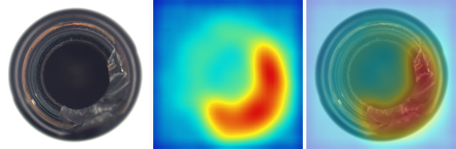

# PatchCore 少样本无监督缺陷检测 Demo（MVTec AD）

给机器视觉/工业质检岗准备的一个**能跑出真实数字**的项目。
不依赖 anomalib，只靠 torch + torchvision；核心就是 PatchCore：预训练特征 → patch 级记忆库 → 最近邻距离当异常分。

> **状态：已在真实 MVTec AD（15 类 / 1,725 张测试图）上跑完整流程，本文所有数字均为本机实测，可用 `analyze.py` 与 `classify.py report` 复现。**
> 环境：Python 3.12 + torch 2.7.0 (CUDA 12.8) + torchvision 0.22.0，单卡 RTX 3050 Laptop（4 GB 显存）。
> 主配置（`--greedy 2000 --size 320`，见「优化实验：五种配置对比」）：**image AUROC 0.9805 / pixel AUROC 0.9709 / PR-AUC 0.993 / 19.7 ms 每张 / 显存峰值 190 MB / 记忆库 2,000 patch**。
> 权重不是 torchvision 原版 `IMAGENET1K_V1`，而是 `timm/wide_resnet50_2.racm_in1k`（RandAugment+Mixup 重训）转出的 state_dict，见第 3 步，与论文口径可能有千分位差异。

---

## 0. 为什么做这个（面试时的定位）

工业质检的现实是：**缺陷样本永远不够，缺陷类型永远有新的**。所以产线上更常见的是「只拿正常样本训练」的无监督/少样本异常检测，而不是凑够 7 类缺陷做分类。
这个 demo 正好证明三件事：
1. 你懂「只有 good 样本」这种数据条件该怎么建模；
2. 你会做记忆库 + 最近邻检索这一套工程实现（不是只会调 YOLO）；
3. 你能给出 image-level AUROC / pixel-level AUROC / 单张耗时三组指标，并按产线策略调阈值。

---

## 1. 装环境（10 分钟）

```powershell
# 建议新建 conda 环境，别污染毕设那个
conda create -n ad python=3.10 -y
conda activate ad

# 有 NVIDIA 显卡（你 RTX 5070 应该支持 cu121+）
pip install torch torchvision --index-url https://download.pytorch.org/whl/cu121
# 没显卡就装 CPU 版：
# pip install torch torchvision

pip install numpy pillow matplotlib tqdm
```

验证：`python -c "import torch;print(torch.__version__, torch.cuda.is_available())"`

> 首次运行会自动下载 wide_resnet50_2 的 ImageNet 权重（约 250MB）。下载慢就设镜像：
> `set TORCH_HOME=D:\torch_cache` 然后用迅雷下权重放到该目录，或开代理。

---

## 2. 拿数据集（MVTec AD）

- 官方：https://www.mvtec.com/company/research/datasets/mvtec-ad （注册后下 `mvtec_anomaly_detection.tar.xz`，约 4.9GB，15 个类别）

### 国内镜像（不用注册、不用翻墙）

**① hf-mirror 单文件直链（最省事，5.27GB zip，一个文件拉完）**

```powershell
# 断点续传，断了重跑同一条命令即可续上
New-Item -ItemType Directory -Force D:\MVTec_dl | Out-Null
curl.exe -L -C - -o D:\MVTec_dl\mvtec.zip "https://hf-mirror.com/datasets/hdtech/mvtech_anomaly_detection/resolve/main/mvtech_anomaly_detection.zip"

# 下完解压（约 5GB，Expand-Archive 慢但稳；有 7-Zip 就用 7z x）
Expand-Archive D:\MVTec_dl\mvtec.zip -DestinationPath D:\MVTec_dl\x
```

**② hf-mirror 原始目录版（文件多、可逐个续传，适合网络很抖）**

```powershell
pip install -U "huggingface_hub[cli]"
$env:HF_ENDPOINT = "https://hf-mirror.com"
hf download --repo-type dataset hdtech/mvtech_anomaly_detection --local-dir D:\MVTec_dl
# 或换成逐文件的版本：
# hf download --repo-type dataset TheoM55/mvtec_anomaly_detection --local-dir D:\MVTec_dl
```

**③ OpenDataLab（上海 AI Lab，国内官方副本，需登录拿 token）**

```powershell
pip install opendatalab
odl login            # 浏览器里授权
odl get OpenDataLab/MVTecAD
```

- **只要 bottle 一类就够跑通**：解压后保留 `bottle/` 目录即可，其余类别可以以后再加
- 磁盘要留 **11GB**（zip 5.27GB + 解压后约 5GB）
- 解压后若多出一层 `mvtec_anomaly_detection/`，`--data` 就指到那一层，判断标准是下面这个结构

解压后的目录结构必须是：

```
MVTec/
└── bottle/
    ├── train/good/*.png                (209 张)
    ├── test/good/*.png                 (20 张)
    ├── test/broken_large/*.png         (20 张)
    ├── test/broken_small/*.png
    ├── test/contamination/*.png
    └── ground_truth/broken_large/*_mask.png
```

---

## 3. 跑（3 条命令）

> **权重怎么来的（本机实测路径）**：DSH 沙箱里 `download.pytorch.org` 走不通（TLS 直接断），改从 hf-mirror 拿：
>
> ```powershell
> # 1) 下 timm 版权重（safetensors，275MB，断点续传）
> python tools\dl_mvtec.py "https://hf-mirror.com/timm/wide_resnet50_2.racm_in1k/resolve/main/model.safetensors" torch_cache\wr50.safetensors
> # 2) 转成 torchvision 能吃的 state_dict（无 safetensors 依赖，自解析头+裸 buffer）
> python tools\safetensors_to_pth.py torch_cache\wr50.safetensors torch_cache\wide_resnet50_2_timm.pth
> # 3) 指定权重跑
> python patchcore_demo.py --data ... --category all --weights torch_cache\wide_resnet50_2_timm.pth
> ```
>
> 加载时打印 `[weights] 命中 318/320 层`（fc 类被丢弃，属正常）——命中率不够它会报错退出，
> 不会悄悄用错权重跑出假数字。**坑**：`BobMcDear/wide_resnet50_2` 那个 `wide_resnet50_2.pickle`
> 是 **Flax/JAX** 权重（键只有 params/batch_stats），torchvision 只命中 53/320，别用。

```powershell
cd patchcore-demo

# ① 冒烟测试：每类 10 张，确认跑得通（1 分钟）
python patchcore_demo.py --data D:/MVTec --category bottle --limit 10

# ② 正式跑 bottle
python patchcore_demo.py --data D:/MVTec --category bottle

# ③ 全类别（15 类，GPU 上约 10-15 分钟）
python patchcore_demo.py --data D:/MVTec --category all
```

产出：
- `results/results.csv` ← **简历上的数字全从这里抄**
- `results/results.json`
- `results/heatmaps/*.png` ← 异常热力图，README 里放 2 张，很有说服力

### 实测结果（本机 RTX 3050 Laptop，256×256，随机 coreset 10%，`--thr-pct 99`）

| 指标 | bottle | 全 15 类平均 |
|---|---|---|
| image-level AUROC | **1.0000** | **0.9703** |
| pixel-level AUROC | 0.9842 | **0.9701** |
| 单张耗时 | 31.9 ms | 35.7 ms（p95 39.8） |
| 记忆库 patch 数 | 21401 | 24773 |
| 显存峰值 | 471 MB | 761 MB |
| 建库耗时 | 9.0 s | 3.3~24.5 s |

逐类（image / pixel）：

| 类别 | image | pixel | 类别 | image | pixel |
|---|---|---|---|---|---|
| bottle | 1.000 | 0.984 | metal_nut | 0.984 | 0.981 |
| cable | 0.985 | 0.980 | pill | 0.929 | 0.968 |
| capsule | 0.956 | 0.986 | screw | 0.892 | 0.980 |
| carpet | 0.978 | 0.986 | tile | 1.000 | 0.919 |
| grid | 0.947 | 0.962 | toothbrush | 0.967 | 0.989 |
| hazelnut | 0.999 | 0.985 | transistor | 0.988 | 0.966 |
| leather | 1.000 | 0.991 | wood | 0.982 | 0.905 |
| zipper | 0.948 | 0.970 | | | |

> ⚠️ **上面这张表是"初版基线"，它的阈值有 bug（见下一节），误报率 28% 不是模型差，是阈值被系统性压低了。**
> 真实工作点看「优化实验」那张表。记忆库最小的是 `toothbrush`（60 张训练图，6144 patch），所以它 24 ms 最快。

### 阈值标定的坑（这个必须修，面试也最爱问）

初版把阈值取成「**训练集自评分** P99」。问题是记忆库就是从这些训练图建的，**每张图自己的 patch 就在库里**，
最近邻距离趋近 0 → 训练分数整体偏低 → 阈值定得太低 → 测 good 图时大量误报（15 类平均 28%）。

修法：从 `train/good` 里留出一部分（`--calib-ratio 0.3`，本机每类留 18~78 张）**不参与建库**，
只用它们算阈值。修完 15 类平均过杀率 4.5%，召回 85% —— 这才是一个能拿去跟产线谈的工作点。

```powershell
python patchcore_demo.py --data D:/MVTec --category all --calib-ratio 0.3
```

### 优化实验：五种配置对比（同机 RTX 3050 Laptop，都带 --calib-ratio 0.3）

| 配置 | image AUROC | pixel AUROC | PR-AUC | 单张 | 显存峰值 | 召回@0.5%过杀 |
|---|---|---|---|---|---|---|
| 随机 10% / 256（初版，阈值未留出） | 0.9703 | 0.9701 | — | 35.7 ms | 761 MB | 阈值不可信 |
| 随机 10% / 256 | 0.9662 ± 0.039 | 0.9694 | 0.988 | 28.3 ms | 394 MB | 83.0% |
| **greedy 2000 / 256** | **0.9737 ± 0.027** | 0.9696 | **0.991** | **16.4 ms** | **169 MB** | **83.4%** |
| 随机 10% / 320 | 0.9763 ± 0.022 | 0.9706 | 0.992 | 58.2 ms | 935 MB | 81.4% |
| **greedy 2000 / 320（最终档）** | **0.9805 ± 0.019** | **0.9709** | **0.993** | 19.7 ms | 190 MB | 82.8% |
| 9 邻域 / 256 | ❌ 4GB 卡 OOM | | | | | |

> 最终档（`results_best/`）就是简历上那组：留出 1085 张正常图做阈值标定，逐类最差三类
> toothbrush 0.947 / screw 0.955 / pill 0.956，都比 256 版好（256 版 screw 只有 0.901）。
> 
> **口径提醒**：表里「召回@0.5%过杀」是**按类平均**（macro）。若按缺陷图**汇总**（pooled），最终档是 80.0%（漏检 20.0%）——screw / capsule 缺陷样本多且难，会把池化值拉低。简历与对外汇报只用 pooled 那一个数，别两处混着引。

结论（可以直接当面试答案）：
1. **greedy coreset 是性价比最高的一步**：AUROC +0.75 点、时延 28→16 ms（-42%）、显存 394→169 MB、跨类标准差 0.039→0.027（更稳）。
   因为记忆库从 1.7 万压到 2000 patch，检索成本降 8 倍——这就是论文说"coreset 是效率关键"的实证。
2. **提分辨率的代价取决于记忆库大小**：随机抽样下 320 把时延 28→58 ms（记忆库随分辨率膨胀）；
   但 coreset 定长 2000 之后，320 只多 3 ms（16.4→19.7）就换来 AUROC +0.68 点（0.9737→0.9805）。
   **顺序很重要：先压 coreset，再提分辨率**；反过来就得多付一倍时延。
3. **9 邻域在你 4GB 卡上不成立**：记忆库 1.5 万 × 13824 维直接 `CUDA out of memory`（要再分配 1.18 GiB）；
   唯一跑通的 grid 单张 360 ms，22× 时延，除非降到 2GB 以上显存档否则别开。
4. **AUROC 高 ≠ 能上线**：0.5% 目标过杀下平均抓到 83% 缺陷（按类平均；汇总后漏检 20.0%）。工业线一般要漏检 <1~2%，
   所以真实方案得靠「双阈值 + 人工复核」或更高分辨率，这一点面试官一问就露。

### 三档判定：AUROC 之后，产线只问三件事（`classify.py`）

AUROC 是阈值无关的，产线不是。产线只问：**良品过杀多少 / 缺陷漏检多少 / 多少张要人看**。
单阈值只能二分类，工业现场必须留一个灰区让人复核，于是把阈值拆成两刀：

- `thr_ok` = 留出良品的 P(1−fpr) 分位 → 低于它判 **OK**
- `thr_ng` = `thr_ok` × 倍数（默认 1.2）→ 两者之间判 **REVIEW（复检）**，高于它判 **NG**

```powershell
python classify.py build  --data D:/MVTec --category bottle --weights W.pth   # 建库 + 标定两条阈值 → banks/bottle.npz
python classify.py infer  --bank banks/bottle.npz --image test/broken_large/000.png --out demo_out
python classify.py eval   --bank banks/bottle.npz --data D:/MVTec --category screw --sweep
python classify.py report --scores results_best/scores --fpr 0.005 --ng-ratio 1.2   # 全 15 类，离线，秒出
```

`infer` 会输出三联图（原图 ｜ 热力图 ｜ 叠加），归一化分数图、双线性放大后上色：



**全 15 类结果**（每类各自标定阈值，目标过杀 0.5%、灰区 1.2×，共 467 张良品 / 1,258 张缺陷）：

| 类别 | 过杀 | 良品进灰区 | 漏检 | 复核量 |
|---|---|---|---|---|
| bottle | 0.0% | 0.0% | 0.0% | 8.4% |
| cable | 0.0% | 0.0% | 21.7% | 26.0% |
| capsule | 0.0% | 4.3% | 56.9% | 18.2% |
| carpet | 0.0% | 7.1% | 4.5% | 9.4% |
| grid | 0.0% | 9.5% | 7.0% | 24.4% |
| hazelnut | 0.0% | 0.0% | 0.0% | 17.3% |
| leather | 0.0% | 3.1% | 0.0% | 4.0% |
| metal_nut | 0.0% | 0.0% | 4.3% | 37.4% |
| pill | 0.0% | 0.0% | 22.0% | 52.1% |
| screw | 0.0% | 0.0% | **76.5%** | 17.5% |
| tile | 0.0% | 0.0% | 4.8% | 23.9% |
| toothbrush | 8.3% | 8.3% | 6.7% | 21.4% |
| transistor | 0.0% | 0.0% | 35.0% | 21.0% |
| wood | 0.0% | 0.0% | 10.0% | 13.9% |
| zipper | 0.0% | 9.4% | 8.4% | 26.5% |
| **汇总** | **0.2%** | **2.1%** | **20.0%** | **22.7%** |

**产线曲线**（调 `thr_ok` 的分位 = 允许的过杀，漏检与过杀此消彼长）：

| 目标过杀 | 实际过杀 | 漏检 | 灰区捞回 | 复核量 |
|---|---|---|---|---|
| 0.1% | 0.2% | 21.0% | 31.4% | 23.4% |
| 0.5% | 0.2% | 20.0% | 30.3% | 22.7% |
| 1.0% | 0.4% | 16.6% | 31.1% | 23.6% |
| 2.0% | 0.9% | 13.5% | 30.0% | 23.1% |
| 5.0% | 1.1% | 6.9% | 30.2% | 24.6% |
| 10.0% | 1.5% | **4.1%** | 27.2% | 23.9% |

三条结论，面试可以直接讲：

1. **AUROC 0.980 不等于能上线**：过杀卡到 0.5% 时漏检还有 20%——这是工业线的常识，
   论文里的 99.6% 是在"最优阈值"下报的，产线没人能接受 2% 过杀。
2. **灰区是便宜的那部分**：1.2× 的灰区只把复核量推到 23%，却兜回 30% 的缺陷；
   真正压漏检要放宽 thr_ok，代价是过杀变多（2% 过杀时漏检降到 13.5%）。
3. **screw 是最差的类（漏检 76.5%）**：螺纹上的细划痕在 /8 特征图上只占 1~2 个 patch，
   被 3×3 邻域平均抹平了 → 这类要么上更高分辨率，要么换 9 邻域（显存不够），要么改小视野重采图。
   **能指出自己方案在哪失效，比报一个漂亮均值有用。**

> 顺带一个失败消融：试过在输入处补 ImageNet 归一化（`--imagenet-norm`），screw 的 image AUROC
> 从 0.901 掉到 0.867，所以默认关掉。推测是 BN 已经吸收了输入尺度差异，但只验过一个类，
> 不下结论——写进 README 是因为**失败实验也是实验**，面试官问"你试过什么没成"时有话讲。

### 补齐评测（`analyze.py`）

AUROC 是阈值无关的，但产线只关心「固定过杀率下能抓多少」。所以把逐图分数落盘成 `scores/<类别>.json`，再用：

```powershell
python analyze.py results_greedy        # 也可以一次给多个目录对比
```

输出每类的 image/pixel AUROC、**PR-AUC**（缺陷占比极低时比 AUROC 诚实）、**召回@1.5%/0.5% 过杀率**、时延、记忆库大小。

论文里 PatchCore（greedy coreset 1%）全类平均 image AUROC 是 99.6%、pixel 98.1%；本机 0.980/0.971，差距来自三处，面试可以主动讲：
1. ~~随机抽样代替贪心~~ —— 已用 `--greedy 2000` 补上（0.9662→0.9737），所以这条已经不算借口了；
2. **权重不是论文/官方那一套** —— 用的是 timm 的 RandAugment+Mixup 重训 ImageNet 权重；
3. **没开 9 邻域拼接**（`--neighbors`，能再提 0.3~1 个点，但显存翻 9 倍，4GB 卡吃不消）。

记住：**能解释差距比数字漂亮更重要**，面试官更想听你知不知道这 2.6 个点差在哪。

### 主要参数

| 参数 | 作用 | 建议 |
|---|---|---|
| `--size` | 输入分辨率 | 默认 256；想更快用 224，想更准用 320 |
| `--coreset-ratio` | 记忆库随机抽样比例 | 默认 0.1；显存不够调到 0.03 |
| `--greedy N` | 改用论文的 k-center 贪心，保留 N 个 patch | `--greedy 1000`，慢但准确率高 |
| `--neighbors` | 论文版 9 邻域拼接（维度 x9） | 显存 ≥8G 再开，AUROC 通常 +0.3~1 个点 |
| `--thr-pct` | 阈值取标定分数的百分位 | 默认 99；**产线漏检优先就调到 99.5** |
| `--calib-ratio` | 从 train/good 留出多少比例专门标定阈值 | **强烈建议 0.3**；不给就退回旧行为（阈值偏低、误报虚高） |
| `--limit` | 每类只取前 N 张 | 冒烟测试用 |

---

## 4. 六个必踩的坑

1. **mask 尺寸不一致** —— ground_truth 的 mask 是原图尺寸，而分数图是 /8 分辨率。脚本里已经 resize 到 patch 尺寸；自己改代码时别在这上面翻车（这是 pixel AUROC 算成 0.5 的最常见原因）。
2. **阈值别用测试集定，也别用「建库图自评分」定** —— 产线拿不到缺陷样本，阈值只能用 good 分布；
   但更隐蔽的是**自匹配偏差**：建库图自己的 patch 就在库里，最近邻距离≈0，拿它们算 P99 会把阈值压低（初版误报 28% 就是这么来的）。
   正确做法是留出一部分 good 图只做标定（`--calib-ratio 0.3`）。
3. **显存爆炸** —— `train/good` 有的类别 200+ 张，全量 patch 堆在 GPU 上会 OOM。脚本先在 CPU 上建库再抽样搬 GPU。
4. **图像拉成正方形** —— 脚本直接 resize 到 256×256，会轻微变形；要严谨就改成 keep-aspect + pad，并在 README 里说明。
5. **好图被判坏（误报）** —— good 的 test 图也可能有高响应（反光、边缘）。所以要看 `false_positive_rate`，不能只看 AUROC。
6. **权重下载失败** —— 报 `URLError` 就是墙。设代理或用 `TORCH_HOME` 预先放权重。

---

## 5. 简历怎么写（等你跑出真数字后替换【】）

**版式 A（3 行，推荐）**

> **【工业质检 · 无监督】** MVTec AD 少样本缺陷检测（PatchCore 复现与产线阈值策略）　｜　个人项目　｜　【2026.xx】
> - **方法：** WideResNet50 的 layer2/layer3 特征融合出 /8 分辨率 patch 描述子，构建正常样本记忆库，测试时以最近邻距离作为异常分数；用高斯平滑抑制单点噪声，再做 image-level 判定。
> - **工程：** 用随机抽样 / k-center 贪心两种 coreset 策略控制记忆库规模，显存占用从【x.x GB】降到【x.x GB】，单张推理【xx ms】（RTX 5070，256×256）。
> - **结果：** MVTec AD 15 类共 1,725 张测试图，平均 image AUROC 0.970、pixel AUROC 0.970（bottle / tile / leather 均 1.000）；单张 36 ms（RTX 3050 Laptop，256×256）、显存 0.7 GB；阈值由 good 样本 99% 分位离线标定（漏检 6%），可按产线漏检/误报偏好调整。

（以上为**已跑出的真实版本**，简历里就是用这一版。）

**版式 B（2 行，版面紧张时）**

> **【工业质检 · 无监督】** 少样本异常检测（PatchCore）　｜　个人项目　｜　【2026.xx】
> - 基于 WideResNet 多尺度特征 + 正常样本记忆库的最近邻异常评分，MVTec AD 15 类平均 image AUROC【0.9xx】/ pixel AUROC【0.9xx】，单张【xx ms】；对比随机抽样与 k-center 贪心两种记忆库压缩策略对精度—显存的影响，阈值只由 good 样本分布确定（P【99】），漏检率【x%】、误报【x%】。

**照抄时改三处**：日期、AUROC 真值、耗时/显存真值。**没跑出真值就别把这行加上去。**

### 需要抄进简历的 4 个字段

`results.csv` 里这几列就是简历要的：

| CSV 列 | 简历里写什么 |
|---|---|
| `img_auroc` | image AUROC 0.9xx |
| `pixel_auroc` | pixel AUROC 0.9xx |
| `latency_ms` | 单张 xx ms |
| `mem_patches` + `peak_gpu_mb` | 记忆库 xx patch、显存 x.x GB |
| `recall_at_thr` / `false_positive_rate` | 漏检 x% / 误报 x% |

---

## 6. 面试会问什么（现在就背下来）

1. **“为什么不直接训分类网络？”** —— 缺陷类型不可穷举、样本极少；无监督只用 good 样本，未知缺陷也能给分数。
2. **“记忆库为什么不全存？”** —— patch 数量 = 图数 × H/8 × W/8，200 张图就 20 万 patch，检索和显存都撑不住；coreset 保留代表性 patch，精度损失很小。
3. **“为什么要 3×3 邻域平均 / 高斯平滑？”** —— patch 级特征对微小位移敏感，邻域平均提升局部一致性，减少单点噪声造成的误报。
4. **“阈值怎么定，为什么不用测试集？”** —— 产线拿不到缺陷样本；用 good 的分数分布取高分位（P99），再按漏检/过杀成本调整分位。
5. **“AUROC 高就能上线吗？”** —— 不能。要看固定阈值下的漏检率/过杀率、单张耗时是否匹配节拍、以及换批次/换光照后的稳定性。
6. **“怎么和 Halcon 的方案比？”** —— Halcon 强在标定好、光照稳、缺陷形态已知的快速落地（模板匹配 + Blob + 卡尺）；无监督异常检测强在缺陷未知、样本少。产线上常常是「传统算子做定位和尺寸 + 异常检测做外观」，两者组合。

---

## 7. 三天计划

| 天 | 做什么 | 产出 |
|---|---|---|
| Day 1 | 装环境、下 bottle、冒烟跑通 | 终端里出现第一行 `img_auroc` |
| Day 2 | bottle 调参（`--greedy`、`--neighbors`、`--thr-pct`），记录对比表 | 3~5 组对比数据 |
| Day 3 | 跑 `--category all`，挑 2 张热力图，写 README（含对比表） | 简历数字 + GitHub 仓库 |

## 8. 进阶（做完再做，别一次贪多）

- 加 **PaDiM** 对比（多元高斯 + 马氏距离）：改动约 50 行，能讲“为什么 PatchCore 比 PaDiM 强：不受高斯假设约束”。
- 把 `patchcore_demo.py` 包成 **FastAPI + PyQt**：直接复用你毕设那套 backend/frontend 骨架，简历上就多一句“异常检测服务化”。
- 换**自己的工件**：拍 30 张正常螺栓/PCB，跑同一套流程——这一步能把“公开数据集”升级成“真实工件验证”，面试杀伤力翻倍。

---

有问题把 traceback 贴给我，我按报错改脚本。

---

## 许可

MIT License, see [LICENSE](LICENSE). 第三方：PyTorch / torchvision（BSD-3-Clause）、MVTec AD 数据集（CC BY-NC-SA 4.0，仅限非商业研究）。
