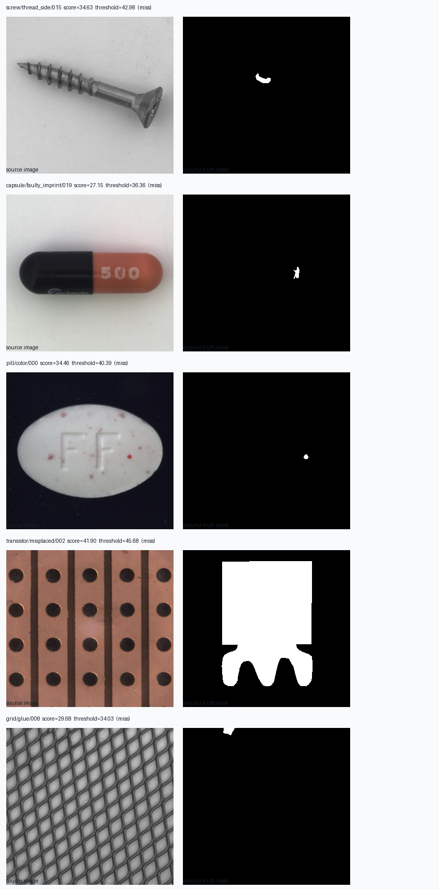

# MVTec 难类失败样例分析

本分析基于 `experiment_data/00_baselines/results_best/scores/*.json` 中记录的单阈值结果。阈值由各类留出的良品 calibration 分数确定；这里的 miss rate 是该阈值下的缺陷漏检比例，不能与三档策略中更严格的 NG 阈值漏检率混用。测试集曾用于多轮方案探索，因此下面用于定位问题，不作为独立最终验证。

## 类别与缺陷子类

| 类别 | 当前阈值下漏检 | 子类漏检率 | 诊断重点 |
|---|---:|---|---|
| screw | 87/119 (73.1%) | thread_side 23/23；manipulated_front 22/24；thread_top 16/23；scratch_head 15/24；scratch_neck 11/25 | 区分螺纹侧面纹理偏差与小划痕；检查小缺陷是否被 /8 patch 表征和图像级 max 汇聚稀释 |
| capsule | 39/109 (35.8%) | scratch 14/23；faulty_imprint 12/22；poke 9/21；crack 4/23；squeeze 0/20 | 文字印刷和细划痕响应弱；检查颜色/印刷本身是否形成正常纹理变化 |
| pill | 27/141 (19.1%) | crack 11/26；color 9/25；scratch 5/24；其余子类较少 | 点状颜色异常和细裂纹需要更高空间分辨率或局部 patch 分析 |
| transistor | 10/40 (25.0%) | misplaced 4/10；cut_lead 3/10；damaged_case 2/10；bent_lead 1/10 | 区分位置/几何异常和表面纹理异常；检查输入 resize 是否损失局部位置关系 |
| grid | 4/57 (7.0%) | glue 2/11；thread 2/11；其他子类 0 miss | 总体阈值召回较好，优先分析 glue/thread 与良品纹理变化，不必先扩大模型复杂度 |

## 代表样例

图中分数均低于相应类别的 P99 校准阈值。例如 screw `thread_side/015` 分数为 34.63，阈值 42.98，标注区域只覆盖螺纹侧面的一小块；pill `color/000` 的局部色点也很小。它们说明全图分数低并不一定意味着没有局部缺陷。capsule `faulty_imprint/019` 的印字异常较细，transistor `misplaced/002` 则更像布局/位置差异，提示不同缺陷机制不能只靠一个统一的“细节不足”解释。

## 下一轮诊断与实验

1. 对 screw、capsule、pill 做同一图像的原图/标注/热力图叠加，逐个确认分数响应落在缺陷区域还是背景纹理。
2. 对图像级评分比较 `max` 与 `top5` 聚合；对局部小缺陷分别测输入尺寸 320 与更高尺寸。训练/校准/test 图片清单保持固定，记录每张图的分数变化。
3. 对 screw 按 `thread_side`、`scratch_*` 子类分别汇报召回；不要仅用类别总 AUROC 判定改动成功。
4. 对 pill/capsule 抽查正常图上的对应区域，检查颜色、印刷和反光是否让异常分数分布重叠。
5. 在固定配置后，使用新的独立样品确认结论；不能继续在当前 MVTec test 上挑参数并把最终结果仍称为独立测试。

当前还没有生成完整的像素热力图失败集；图中展示的是原图与 ground-truth mask，数值来自落盘的 image scores。热力图叠加和人工标注复核是后续分析项。
