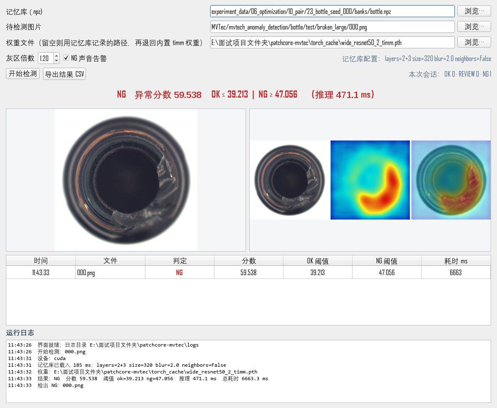

# 面试现场演示流程

## 演示目标

用一张 MVTec bottle 异常图完整展示“输入图 → PatchCore 特征/记忆库检索 → OK/REVIEW/NG → 热力图”，并能解释分数阈值来自独立良品 calibration。该流程是桌面原型，不应表述为产线部署。

## 准备

当前工作区已有协议内记忆库 `experiment_data/06_optimization/10_pair/23_bottle_seed_000/banks/bottle.npz`（2+3 / 1536 维 / thr_ok 39.21）、权重文件和 MVTec 图像。旧库 `experiment_data/04_memory_banks/banks/bottle.npz` 是早期 P99 口径（thr_ok 39.94），仍可演示但数字不同。桌面演示需要 `.venv` 中的 PyTorch、torchvision、Pillow 和 PyQt5。

启动界面：

```powershell
cd E:\面试项目文件夹\patchcore-mvtec
.\.venv\Scripts\python.exe pyqt_demo.py
```

界面中选择：

- 记忆库：`experiment_data/06_optimization/10_pair/23_bottle_seed_000/banks/bottle.npz`
- 权重：`torch_cache/wide_resnet50_2_timm.pth`
- 图片：`MVTec/mvtech_anomaly_detection/bottle/test/broken_large/000.png`

预期显示 NG、异常分数约 59.5、阈值 OK≤39.21 / NG≥47.06（灰区 ×1.2），以及热力图。CLI 输出保存在 `experiment_data/06_optimization/13_demo/`。分数会因设备、依赖版本和计时环境有轻微差异（±1%）。



## 界面能力

- **图像显示**：左侧原图、右侧三联图（原图 / 异常热力图 / 叠加），按 `KeepAspectRatio` 缩放，不拉伸。
- **参数**：记忆库、图片、权重三行路径；灰区倍数（`NG 阈值 = OK 阈值 × 倍数`，默认 1.2）可现场调；右侧只读显示记忆库自带配置（`layers / size / blur / neighbors`），避免在界面上改建库参数造成静默错配。
- **结果**：彩色判定横幅（OK 绿 / REVIEW 琥珀 / NG 红）+ 分数 + 两条阈值 + 单图推理耗时；下方明细表记录每次检测（时间 / 文件 / 判定 / 分数 / 阈值 / 耗时），可「导出结果 CSV」。
- **日志**：底部日志面板实时显示载库、权重命中、推理与判定过程，同时写入 `logs/demo_YYYYMMDD.log`；退出时清理临时热力图。
- **报警**：检出 NG 时窗口标题前缀「⚠ NG 检出」、计数增加、并发出系统提示音（可关闭）；REVIEW 只改标题不发声。

界面与 CLI 同口径：预处理 / 裁剪 / 平滑 / 邻域填充都从记忆库 `meta` 读取，不是写死参数。离屏自检（不开窗口、渲染截图）：

```powershell
$env:QT_QPA_PLATFORM='offscreen'; $env:QT_QPA_FONTDIR='C:\Windows\Fonts'
.\.venv\Scripts\python.exe pyqt_demo.py --selftest --shot demo.png `
  --bank experiment_data/06_optimization/10_pair/23_bottle_seed_000/banks/bottle.npz `
  --image MVTec/mvtech_anomaly_detection/bottle/test/broken_large/000.png
```

## 命令行备用演示

如果 GUI 环境不可用，可运行同一张图的推理并保存三联图：

```powershell
.\.venv\Scripts\python.exe classify.py infer `
  --bank experiment_data/06_optimization/10_pair/23_bottle_seed_000/banks/bottle.npz `
  --image MVTec/mvtech_anomaly_detection/bottle/test/broken_large/000.png `
  --weights torch_cache/wide_resnet50_2_timm.pth `
  --out experiment_data/06_optimization/13_demo
```

本轮已验证该命令输出 NG（分数 59.54，阈值 39.21 / 47.06），结果图在 `experiment_data/06_optimization/13_demo/`（目录已 gitignore，可复算）。也已用 Qt offscreen 驱动界面中的异步推理路径，确认能完成并显示热力图。

## 面试讲解顺序

1. 说明建库只使用良品，异常图只用于推理展示。
2. 指出热力图是异常相似度响应，分数不是缺陷概率。
3. 解释 OK / REVIEW / NG 的双阈值如何从校准良品确定。
4. 展示一个失败样例，并说明 MVTec 当前是开发集，真实工件仍需独立批次验证。

界面里真实存在的是「桌面级」三档判定、声音提示、结果表与运行日志；**不要**声称已有 PLC、相机触发、节拍联锁、MES 上报或产线级报警集成——这些没有实现。
